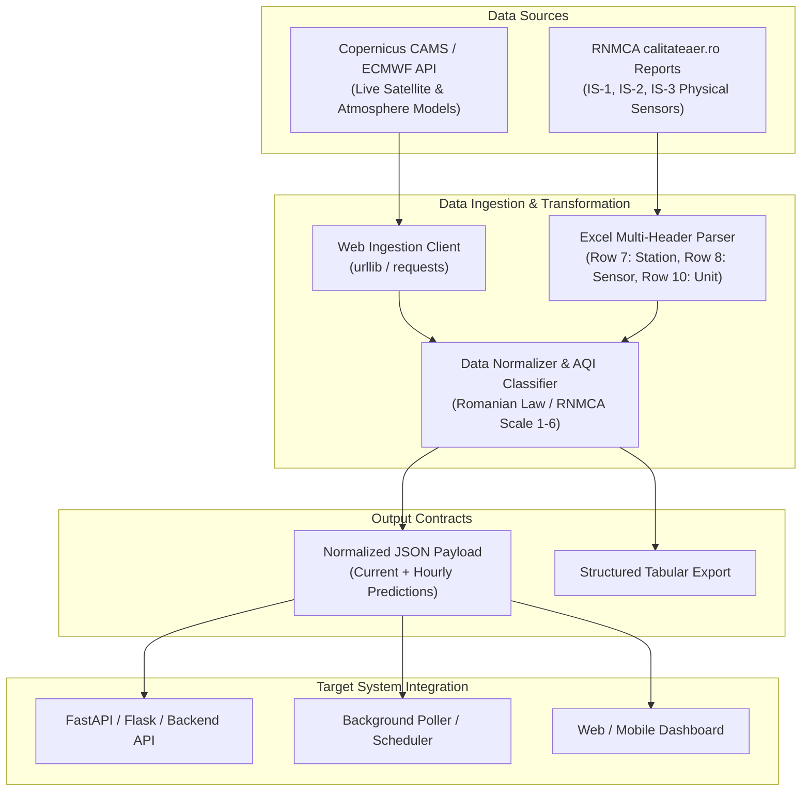

# Air Quality Data & Prediction Integration Guide

> **Target Audience**: AI Coding Assistants, System Architects, and Software Engineers integrating Iași Air Quality services into another codebase.

---

## 1. Executive Summary

This document specifies how to extract, process, and integrate real-time and forecasted air quality data for **Iași, Romania** (Coordinates: `47.16° N, 27.58° E`).

The system supports two complementary data pipelines:
1. **Live Web Workflow (Recommended for general integration)**: Zero-dependency real-time retrieval from the **Copernicus Atmosphere Monitoring Service (CAMS / ECMWF)** via Open-Meteo Air Quality API. Provides current concentrations + 72-hour hourly forecasts for PM2.5, PM10, NO2, O3, SO2, and European AQI without requiring local training or API keys.
2. **Ground Station Workflow (Historical / Offline)**: Ingestion of official Romanian Ministry of Environment (**RNMCA**) multi-station Excel reports from the 3 physical stations in Iași (IS-1 Trafic, IS-2 Fond Urban & Meteo, IS-3 Industrial).

---

## 2. System Workflow & Data Flow



---

## 3. "Get The Data" Workflow (Live Web Model)

### 3.1 Endpoint Specification

* **Protocol**: HTTPS GET (REST JSON)
* **Base URL**: `https://air-quality-api.open-meteo.com/v1/air-quality`
* **Authentication**: None required (Public open scientific data)
* **Rate Limits**: Generous free tier (up to 10,000 requests/day)

### 3.2 Request Parameters for Iași

| Parameter | Value | Description |
| :--- | :--- | :--- |
| `latitude` | `47.16` | Latitude for Iași center |
| `longitude` | `27.58` | Longitude for Iași center |
| `current` | `european_aqi,pm10,pm2_5,nitrogen_dioxide,ozone,sulphur_dioxide` | Current hourly real-time readings |
| `hourly` | `pm10,pm2_5,nitrogen_dioxide,ozone,sulphur_dioxide,european_aqi` | Hourly series (history + forecast) |
| `forecast_days` | `1` to `7` (Default: `3`) | Number of forecast days into the future |
| `timezone` | `auto` (resolves to `Europe/Bucharest`) | Local Romanian time zone alignment |

### 3.3 Full Query URL Example

```http
GET https://air-quality-api.open-meteo.com/v1/air-quality?latitude=47.16&longitude=27.58&current=european_aqi,pm10,pm2_5,nitrogen_dioxide,ozone,sulphur_dioxide&hourly=pm10,pm2_5,nitrogen_dioxide,ozone,sulphur_dioxide,european_aqi&forecast_days=3&timezone=auto
```

### 3.4 Raw JSON Response Structure

```json
{
  "latitude": 47.159996,
  "longitude": 27.58,
  "generationtime_ms": 0.42,
  "utc_offset_seconds": 10800,
  "timezone": "Europe/Bucharest",
  "current": {
    "time": "2026-10-17T15:00",
    "interval": 3600,
    "european_aqi": 25,
    "pm10": 9.9,
    "pm2_5": 7.7,
    "nitrogen_dioxide": 4.2,
    "ozone": 36.0,
    "sulphur_dioxide": 0.5
  },
  "hourly": {
    "time": ["2026-10-17T00:00", "2026-10-17T01:00", ...],
    "pm10": [5.4, 5.3, ...],
    "pm2_5": [4.8, 4.8, ...],
    "nitrogen_dioxide": [3.2, 2.8, ...],
    "ozone": [32.0, 31.0, ...],
    "sulphur_dioxide": [0.4, 0.4, ...],
    "european_aqi": [19, 19, ...]
  }
}
```

---

## 4. Official RNMCA / Romanian Air Quality Index Standards

When presenting or analyzing data, raw concentrations ($\mu g/m^3$) must be converted to the official **RNMCA scale (1 to 6)** according to Romanian environmental legislation:

| AQI Code | Calificativ (RO) | PM 2.5 ($\mu g/m^3$) | PM 10 ($\mu g/m^3$) | NO2 ($\mu g/m^3$) | Recomandare de Sănătate |
| :---: | :--- | :--- | :--- | :--- | :--- |
| **1** | **Bun** | $0.0 - 5.0$ | $0.0 - 15.0$ | $0.0 - 10.0$ | Calitate excelentă. Aer curat, sigur pentru toată populația. |
| **2** | **Acceptabil** | $5.0 - 15.0$ | $15.0 - 45.0$ | $10.0 - 25.0$ | Calitate bună. Fără restricții pentru activități fizice. |
| **3** | **Moderat** | $15.0 - 50.0$ | $45.0 - 120.0$ | $25.0 - 60.0$ | Poluare ușoară. Persoanele extrem de sensibile pot resimți iritații. |
| **4** | **Rău** | $50.0 - 90.0$ | $120.0 - 195.0$ | $60.0 - 100.0$ | Reduceți efortul fizic intens în aer liber. |
| **5** | **Foarte Rău** | $90.0 - 140.0$ | $195.0 - 270.0$ | $100.0 - 150.0$ | Nivel dăunător. Evitați plimbările copiilor și vârstnicilor. |
| **6** | **Extrem de Rău** | $> 140.0$ | $> 270.0$ | $> 150.0$ | Alertă sanitară majoră. Rămâneți în interior cu ferestrele închise. |

---

## 5. Offline Ground Sensor Workflow (RNMCA Excel Ingestion)

If the target project needs to process raw files downloaded from [calitateaer.ro](https://www.calitateaer.ro):

1. **Station Identifiers in Iași**:
   - `IS-1`: Bvd. Nicolae Iorga (Urban Traffic)
   - `IS-2`: Aleea Decebal (Urban Background + Full Meteorological Station MTX)
   - `IS-3`: Str. Han Tătar (Industrial / Suburban)
2. **Excel Header Hierarchy**:
   - Row 7: Station Name (`IS-1`, `IS-2`, `IS-3`, `Zi/Ora`)
   - Row 8: Chemical Compound / Instrument (`Derenda APM2 - PM 2.5`, `9841B - NO2`, `MTX - Viteza vantului`)
   - Row 9: Metric type (`Valori orare`, `Media mobila orara`, `Valori zilnice`)
   - Row 10: Measurement unit (`Valoare [µg/m³]`, `Valoare [°C]`, `Valoare [m/s]`)
3. **Timestamp Normalization**:
   - Format: `YYYY-MM-DD HH` (where hours are `01` to `24`).
   - If hour is `24`: add 1 day and set hour to `00:00:00`.
   - String `'-'` denotes sensor dropout or missing value $\to$ convert to `NaN`.

---

## 6. Drop-In Python Module for Target Projects

Copy and paste this single, self-contained Python file into any target project (e.g. `services/air_quality.py`). It requires **zero external packages** (uses only standard library `urllib` and `json`).

```python
"""
Iași Air Quality Service (Drop-in module for target projects).
Zero external dependencies. Uses Python standard library.
"""

import json
import urllib.request
from typing import Dict, Any, List

class AirQualityService:
    # Iași, Romania default coordinates
    DEFAULT_LAT = 47.16
    DEFAULT_LON = 27.58

    AQI_THRESHOLDS = {
        "PM2.5": [(0, 5, 1, "Bun"), (5, 15, 2, "Acceptabil"), (15, 50, 3, "Moderat"), (50, 90, 4, "Rau"), (90, 140, 5, "Foarte rau"), (140, 10000, 6, "Extrem de rau")],
        "PM10":  [(0, 15, 1, "Bun"), (15, 45, 2, "Acceptabil"), (45, 120, 3, "Moderat"), (120, 195, 4, "Rau"), (195, 270, 5, "Foarte rau"), (270, 10000, 6, "Extrem de rau")],
        "NO2":   [(0, 10, 1, "Bun"), (10, 25, 2, "Acceptabil"), (25, 60, 3, "Moderat"), (60, 100, 4, "Rau"), (100, 150, 5, "Foarte rau"), (150, 10000, 6, "Extrem de rau")]
    }

    @classmethod
    def get_aqi_badge(cls, pollutant: str, value: float) -> Dict[str, Any]:
        bands = cls.AQI_THRESHOLDS.get(pollutant, [])
        for low, high, code, label in bands:
            if low <= value < high:
                return {"code": code, "label": label}
        if bands:
            return {"code": bands[-1][2], "label": bands[-1][3]}
        return {"code": 0, "label": "Necunoscut"}

    @classmethod
    def fetch_air_quality(cls, lat: float = DEFAULT_LAT, lon: float = DEFAULT_LON, forecast_days: int = 3) -> Dict[str, Any]:
        """
        Fetches current status and hourly air quality predictions.
        Returns a clean structured dictionary.
        """
        url = (
            f"https://air-quality-api.open-meteo.com/v1/air-quality?"
            f"latitude={lat}&longitude={lon}"
            f"&current=european_aqi,pm10,pm2_5,nitrogen_dioxide,ozone,sulphur_dioxide"
            f"&hourly=pm10,pm2_5,nitrogen_dioxide,ozone,sulphur_dioxide,european_aqi"
            f"&forecast_days={forecast_days}"
            f"&timezone=auto"
        )
        req = urllib.request.Request(url, headers={"User-Agent": "AirQualityIntegration/1.0"})
        with urllib.request.urlopen(req, timeout=10) as resp:
            raw = json.loads(resp.read().decode("utf-8"))

        curr = raw.get("current", {})
        hourly = raw.get("hourly", {})

        pm25 = curr.get("pm2_5", 0.0)
        pm10 = curr.get("pm10", 0.0)
        no2  = curr.get("nitrogen_dioxide", 0.0)

        # Enrich current state
        current_summary = {
            "timestamp": curr.get("time"),
            "pm2_5": {"value": pm25, "unit": "µg/m³", **cls.get_aqi_badge("PM2.5", pm25)},
            "pm10":  {"value": pm10, "unit": "µg/m³", **cls.get_aqi_badge("PM10", pm10)},
            "no2":   {"value": no2,  "unit": "µg/m³", **cls.get_aqi_badge("NO2", no2)},
            "ozone": {"value": curr.get("ozone", 0.0), "unit": "µg/m³"},
            "so2":   {"value": curr.get("sulphur_dioxide", 0.0), "unit": "µg/m³"},
            "european_aqi": curr.get("european_aqi")
        }

        # Build hourly forecast sequence
        forecast_timeline: List[Dict[str, Any]] = []
        times = hourly.get("time", [])
        for i in range(len(times)):
            f_pm25 = hourly["pm2_5"][i]
            f_pm10 = hourly["pm10"][i]
            forecast_timeline.append({
                "datetime": times[i],
                "pm2_5": f_pm25,
                "pm10": f_pm10,
                "no2": hourly["nitrogen_dioxide"][i],
                "ozone": hourly["ozone"][i],
                "european_aqi": hourly["european_aqi"][i],
                "aqi_pm25_code": cls.get_aqi_badge("PM2.5", f_pm25)["code"],
                "aqi_pm25_label": cls.get_aqi_badge("PM2.5", f_pm25)["label"]
            })

        return {
            "city": "Iasi",
            "coordinates": {"latitude": lat, "longitude": lon},
            "current": current_summary,
            "forecast_hourly": forecast_timeline
        }

# Usage Example:
if __name__ == "__main__":
    data = AirQualityService.fetch_air_quality()
    print("Iași Air Quality Right Now:")
    print(f"  PM 2.5: {data['current']['pm2_5']['value']} µg/m³ ({data['current']['pm2_5']['label']})")
    print(f"  PM 10:  {data['current']['pm10']['value']} µg/m³ ({data['current']['pm10']['label']})")
    print(f"Total hourly points retrieved: {len(data['forecast_hourly'])}")
```

---

## 7. Instructions for an AI Assistant Integrating This into Another Project

When you (the AI assistant) are tasked with integrating this into another project, follow these exact steps:

1. **Add the Module**:
   - Create `services/air_quality_service.py` (or corresponding path) and paste the [`AirQualityService`](#6-drop-in-python-module-for-target-projects) class code above.
2. **If Target Project is a Web Backend (FastAPI / Flask / Django)**:
   - Expose an endpoint `GET /api/v1/air-quality` returning `AirQualityService.fetch_air_quality()`.
   - Add a 10-minute caching layer (`lru_cache` or Redis) to avoid redundant HTTP calls on high traffic.
3. **If Target Project is a Mobile App or Frontend (React / Vue / Next.js)**:
   - Consume the `current` object for status badges (`Bun`, `Acceptabil`, `Moderat`).
   - Feed `forecast_hourly` into a Chart.js, Recharts, or ApexCharts `<LineChart />` component.
4. **If Target Project needs Notifications / Alerts (Telegram / Email / Webhook)**:
   - Schedule a periodic job (e.g. every hour).
   - If `data['current']['pm2_5']['code'] >= 3` (Moderat or higher), dispatch an alert notification to the user.
